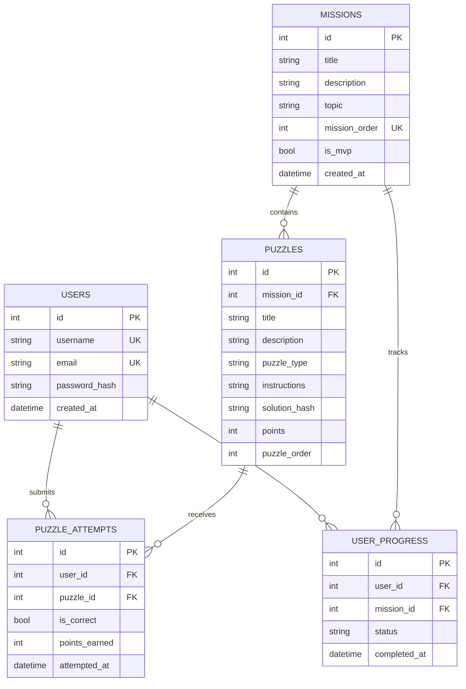

# Cyber Heist schema

The application stores accounts, missions, puzzles, attempts, and mission
progress. Leaderboard totals are not a table. They are calculated from
correct rows in `puzzle_attempts`, keeping only the best score for each
player on each puzzle.

`schema.sql` and `seed.sql` are executable SQLite scripts. They match the
SQLAlchemy models in `backend/models.py`. The running app creates and fills
the database through SQLAlchemy (`python seed.py`). You can also apply the
SQL files with the `sqlite3` command. They are maintained source files, not
exports taken from a live database file.

Notes:

- `PUZZLES` has a unique pair of `mission_id` and `puzzle_order`.
- `USER_PROGRESS` has a unique pair of `user_id` and `mission_id`.
- `status` is one of `locked`, `available`, `in_progress`, or `completed`.
- `solution_hash` is a SHA-256 digest. The answer text is not stored.
- `password_hash` is a PBKDF2 hash. The password text is not stored.
- Foreign keys are enforced with `PRAGMA foreign_keys = ON`.
- Deleting a mission that still has puzzles is rejected. The same is true for users or puzzles that still have attempts or progress rows.
- Mission unlock order is not represented by an extra table. Sample progress rows are snapshots, and the real unlock rule is still an open design choice.
